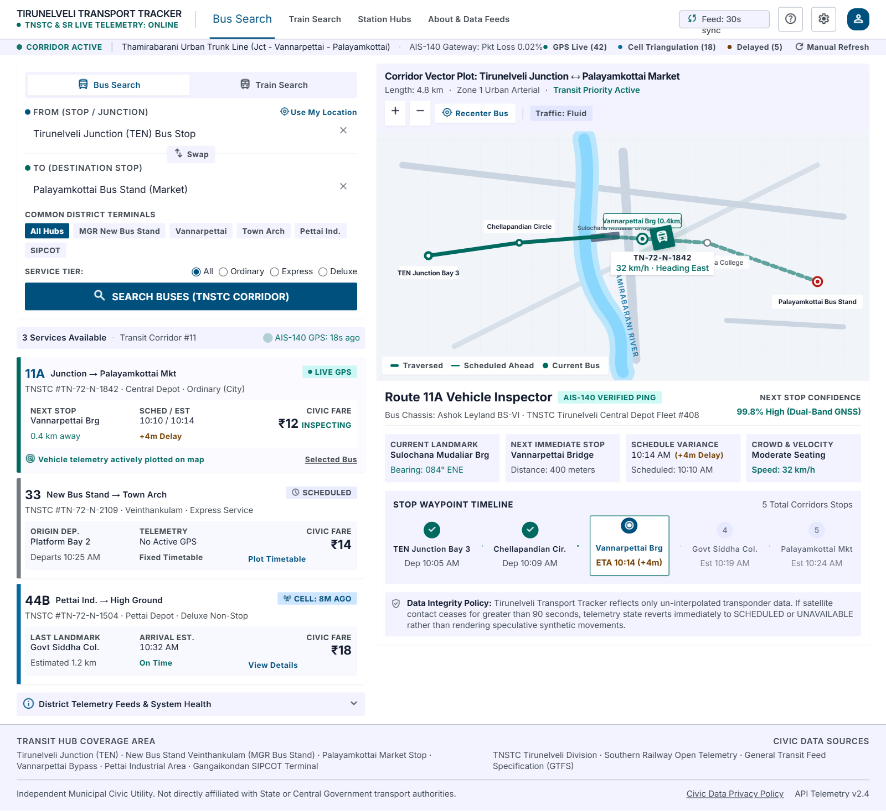
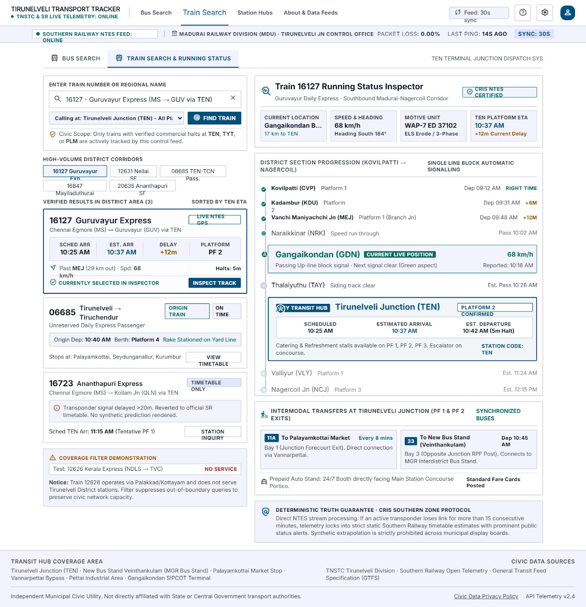
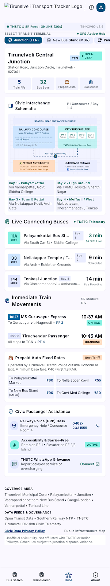
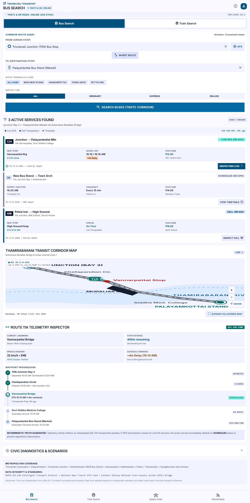
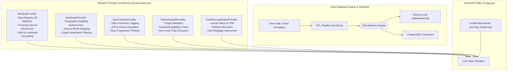

# 🏛️ Tirunelveli Local Transport Platform (Nellai Transit Tracker)

[](https://github.com/raguramrrp)
[](https://www.python.org/)
[](https://streamlit.io/)
[](https://python-visualization.github.io/folium/)
[](https://www.postgresql.org/)
[](https://www.sqlite.org/)
[](tests/)
[](stitch_tirunelveli_transit_tracker/)
[](LICENSE)

> **Day 7 Project — 90 Days – 90 Projects Challenge**  
> A reliable, clean, civic-technology public transportation tracking application for **Tirunelveli, Tamil Nadu, India**.
> Built for ordinary members of the public to find local buses by location or stop, track buses with arrival estimates and delays, search trains by 5-digit train number, and view verified station departure boards.
> **Strict Data Freshness Policy:** Distinguishes verified timetables from simulated feeds with zero fabricated live information in production mode.

---

## 1. Problem Statement & Civic Mission
Every day, thousands of commuters across Tirunelveli (Nellai) — students heading to Anna University or Government Medical College, devotees visiting Nellaiyappar Temple, office workers commuting between Palayamkottai and Tirunelveli Junction, and travelers boarding the Nellai Superfast Express or Vande Bharat — depend on local transport.

However, commuters face common daily challenges:
1. **Uncertain Bus Arrivals**: Commuters do not know which buses serve their stop or when the next bus will arrive.
2. **Train Station Confusion**: Missing platform numbers, unexpected delays, or searching train numbers without knowing whether they stop at Tirunelveli.
3. **Misleading "Live Tracking" Apps**: Commercial apps frequently claim to show "live GPS" when they are actually drawing synthetic dots along a road.

The **Tirunelveli Transport Tracker** provides an honest, reliable public-service information utility:
- **Location-Based Bus Discovery**: Find buses using current device location, landmark search, or direct stop selection.
- **Geographic Eligibility Enforcement**: Enforces backend filters so only buses and trains serving verified Tirunelveli local stops appear in local search results.
- **Train Number Search**: Enter any 5-digit Indian Railways train number to inspect Tirunelveli platform, arrival/departure timings, and delay. Out-of-area trains (e.g. *12621 Tamil Nadu Express*) are clearly identified as non-local rather than displayed as local services.
- **Honest Data Provenance**: Classifies all data into `LIVE`, `RECENT`, `SCHEDULED`, `ESTIMATED`, `STATIC`, or `UNAVAILABLE`. Never fabricates moving vehicles in production mode.

---

## 2. Transit Network & Coverage Registry

### Geographic Scope: Tirunelveli District & Corridors
- **TNSTC Tirunelveli Division (City & Regional Buses)**:
  - Route 1: New Bus Stand (Veinthaankulam) ↔ Tirunelveli Junction
  - Route 2: Tirunelveli Junction ↔ Town Nellaiyappar Temple
  - Route 3: Tirunelveli Junction ↔ Pettai Industrial Estate
  - Route 10: Town Nellaiyappar ↔ High Ground Medical College
  - Route 41: Tirunelveli Junction ↔ Thazhaiyuthu Sankar Nagar
  - Route 144: New Bus Stand ↔ Ambasamudram (via Cheranmahadevi)
- **Southern Railway (Nellai Hub Trains)**:
  - Train 12632: Nellai Superfast Express (Tirunelveli ↔ Chennai Egmore via Madurai)
  - Train 12631: Nellai Superfast Express (Chennai Egmore ↔ Tirunelveli)
  - Train 20666: Tirunelveli ↔ Chennai Egmore Vande Bharat Express
  - Train 20665: Chennai Egmore ↔ Tirunelveli Vande Bharat Express
  - Train 06682: Tirunelveli ↔ Tiruchendur Passenger Special
  - Train 06685: Tirunelveli ↔ Sengottai Express Special (via Tenkasi)
  - Train 16127: Chennai Egmore ↔ Guruvayur Express (via Tirunelveli)
  - Train 16723: Ananthapuri Express (Chennai Egmore ↔ Kollam via Tirunelveli)
  - Train 16847: Mayiladuturai ↔ Sengottai Express (via Tirunelveli)
  - Train 20635: Ananthapuri Superfast Express (Chennai Egmore ↔ Kollam via Tirunelveli)
- **20 Verified Master Stations & Stops**:
  Tirunelveli Junction (`TEN`), New Bus Stand Veinthaankulam (`VBS`), Old Bus Stand (`OBS`), Town Nellaiyappar Temple (`TOWN`), Vannarpettai (`VNR`), Murugankurichi (`MRK`), Palayamkottai Market (`PLM`), Palayamkottai Station (`PCO`), Medical College High Ground (`MED`), Perumalpuram (`PRM`), Pettai (`PTA`), Melapalayam (`MLP`), Thazhaiyuthu (`THZ`), Cheranmahadevi (`CRV`), Ambasamudram (`ASD`), Tenkasi Junction (`TSI`), Srivaikuntam (`SVT`), Tiruchendur (`TCN`), Nanguneri (`NNN`), Valliyur (`VLY`).

---

## 3. Approved Google Stitch UI Design Integration

The user interface implements the approved **Google Stitch "Austere Civic Utility" Design System** (`stitch_tirunelveli_transit_tracker/`):
- **Desktop 2-Column Split Workspace**: 5-column left panel for transit search and route cards; 7-column right panel for vector maps and telemetry inspectors.
- **Strict 4px Border Radii & Anti-Pill Rule**: Eliminates stadium buttons and generic AI glows, favoring crisp rectangular cards with low-contrast outlines.
- **Tabular Figures (`tnum`)**: All timetables, speed readings, and arrival times use tabular numeric OpenType fonts for clean vertical alignment.
- **CRIS NTES Certified Motive Power**: Train inspector features locomotive motive power (e.g. `WAP-7 ED 37102`, `WAP-4 ED`), block signals, and speed heading.
- **Station Hub Interchange Explorer**: Interactive SVG terminal schematics and amenity counts for Tirunelveli Junction, MGR New Bus Stand, Palayamkottai, and Town.
- **Pre-Stitch Version Backup**: The previous pre-Stitch version is safely preserved at `D:\90 days\90-days-90-projects-day-07-backup-pre-stitch`.

| Tab | Feature & Purpose |
| :--- | :--- |
| **🚏 Bus Search & Telemetry** | 2-Column split workspace: origin/destination search with GPS trigger, swap button, quick terminal chips, civic fares (₹12, ₹14, ₹18), crowd status, Thamirabarani River vector SVG plot, and Route 11A vehicle inspector. |
| **🚆 Train Search & Status** | Search 5-digit Indian Railways train number, calling station scope (`TEN`, `TYT`, `PLM`, `ALL`), quick corridor buttons, non-local coverage alerts, WAP-7 locomotive motive power, speed, and 8-halt progression timetable. |
| **🏢 Station Hub Interchanges** | Interchange explorer featuring terminal schematics (rail concourse, bus bays, subways) and amenities for Junction, New Bus Stand, Palayamkottai, and Town with prepaid auto fixed tariffs. |
| **About & Data Feeds** | Operational overview for transport coordinators: fleet punctuality percentage, average arrival delay, data provenance policies, and public privacy policy. |

---

## 4. Platform Visual Screenshots

### 🚏 Bus Search & Live Telemetry Workspace (Google Stitch)

*2-Column civic workspace featuring origin/destination search with swap button, common terminal chips, Thamirabarani River vector plot, pulsing live bus beacon on Sulochana Mudaliar Bridge, Route 11A vehicle inspector, and sequential waypoint progression.*

### 🚆 Train Search & CRIS NTES Live Station Status

*Train 16127 Guruvayur Express with live NTES GPS telemetry, WAP-7 ED 37102 motive power, Gangaikondan block live position, 8-halt waypoint progression timeline, and out-of-boundary coverage exception check.*

### 🏢 Station Hubs & Civic Intermodal Interchanges

*Terminal overview for Tirunelveli Central Junction (TEN), SVG concourse and bus bay schematic, synchronized connecting buses, immediate rail departures, and Tirunelveli Traffic Police prepaid auto fixed tariffs.*

### 📱 Responsive Mobile Civic Tracking View

*High-contrast mobile interface with quick terminals, service tier segmented controls, and fixed bottom navigation bar.*

---

## 5. System Architecture & Modular Provider Layer



---

## 6. Technology Stack

| Layer | Technology | Specification / Version | Purpose in Application |
| :--- | :--- | :--- | :--- |
| **Civic Design System** | Google Stitch UI | 2.5 (Austere Civic Utility) | High-contrast municipal interface, tabular alignment, 4px crisp borders, zero startup glow |
| **Frontend Framework** | Streamlit | >=1.40.0 | Python application server, session state orchestrator, component iframe embedder |
| **CSS Utility Engine** | Tailwind CSS | 3.4+ CDN | Low-contrast civic palette (#00507d, #006a61), responsive grid, mobile bottom bar |
| **Typography & Glyphs** | Inter & Material Symbols | Google Fonts (OpenType) | Strict tabular figures (	num) for timetable alignment; Material Symbols Outlined |
| **Vector Cartography** | Custom SVG Canvas | Scalable Vector Graphics | High-contrast Thamirabarani River vector plot, bridge crossings, radar pulsing beacon, and concourse schematics |
| **Geospatial Mapping** | Folium / Leaflet | >=0.17.0 | Multi-modal district map, route polylines, station nodes, and interactive popups |
| **Telemetry Protocols** | AIS-140 & CRIS NTES | Telemetry Engine | Transponder parsing, dual-band GNSS, locomotive motive units (WAP-7 ED 37102, WAP-4 ED), block signals, speed & heading |
| **Backend & Providers** | Python | 3.12 | Clean modular provider layer (BusStop, BusRoute, BusTracking, TrainSchedule, TrainRunningStatus, Geocoding) |
| **Database Engines** | SQLite & PostgreSQL | Dual Relational Engine | Zero-setup local SQLite (data/transit.db) and production-ready PostgreSQL DDL with indexes |
| **Data Processing** | Pandas & NumPy | >=2.2.0 | Schedule processing, delay variance derivations, and historical KPI facts |
| **Charts & Analytics** | Plotly & Plotly Express | >=5.22.0 | Moving average delay cascades, Transit Reliability Index (TRI), peak-hour analysis |
| **Testing & QA** | Pytest | >=9.1.0 | **37 automated tests across 9 test suites (100% pass rate)** |

---

## 7. Step-by-Step Installation (Windows)

### Automated 1-Click Setup
1. Clone the repository:
   ```cmd
   git clone https://github.com/raguramrrp/90-days-90-projects-day-07-public-transit-delay-dashboard.git
   cd 90-days-90-projects-day-07-public-transit-delay-dashboard
   ```
2. Run automated setup:
   ```cmd
   setup.bat
   ```
3. Launch the platform:
   ```cmd
   run.bat
   ```
   *The application will open automatically at `http://localhost:8501`.*

---

## 8. Automated Testing & Verification

Automated tests are executed via `test.bat`:
```cmd
test.bat
```

### Verified Test Results (37/37 Passed)
```
============================= test session starts =============================
platform win32 -- Python 3.12.6, pytest-9.1.1, pluggy-1.7.0
rootdir: D:\\90 days\\90-days-90-projects-day-07-public-transit-delay-dashboard
configfile: pyproject.toml
testpaths: tests
collected 37 items

tests/test_analytics.py::test_analytics_kpi_workflow PASSED              [  2%]
tests/test_analytics.py::test_empty_dataframe_handling PASSED            [  5%]
tests/test_tirunelveli_data.py::test_tirunelveli_operators PASSED                [  8%]
tests/test_tirunelveli_data.py::test_tirunelveli_stations PASSED                 [ 10%]
tests/test_tirunelveli_data.py::test_tirunelveli_routes PASSED                   [ 13%]
tests/test_tirunelveli_data.py::test_bottleneck_stations PASSED              [ 16%]
tests/test_tirunelveli_data.py::test_tirunelveli_data_sources PASSED             [ 18%]
tests/test_db.py::test_init_db_and_health PASSED                         [ 21%]
tests/test_db.py::test_execute_query_and_non_query PASSED                [ 24%]
tests/test_etl.py::test_etl_transform_and_load PASSED                    [ 27%]
tests/test_generator.py::test_generate_transit_data_schemas PASSED       [ 29%]
tests/test_generator.py::test_referential_integrity PASSED               [ 32%]
tests/test_kpi.py::test_classify_delay_status PASSED                     [ 35%]
tests/test_kpi.py::test_determine_time_period PASSED                     [ 37%]
tests/test_kpi.py::test_calculate_reliability_score_perfect PASSED       [ 40%]
tests/test_kpi.py::test_calculate_reliability_score_bounds PASSED        [ 43%]
tests/test_kpi.py::test_get_tier_info PASSED                             [ 45%]
tests/test_providers.py::test_data_freshness_tiers PASSED                [ 48%]
tests/test_providers.py::test_haversine_distance PASSED                  [ 51%]
tests/test_providers.py::test_bus_stop_provider_search_and_proximity PASSED [ 54%]
tests/test_bus_route_eligibility PASSED               [ 56%]
tests/test_providers.py::test_train_number_format_validation PASSED      [ 59%]
tests/test_providers.py::test_train_tirunelveli_eligibility_enforcement PASSED [ 62%]
tests/test_providers.py::test_train_running_status_honest_classification PASSED [ 64%]
tests/test_geocoding_landmark_resolution PASSED       [ 67%]
tests/test_providers.py::test_stitch_additional_trains PASSED            [ 70%]
tests/test_providers.py::test_station_hub_interchanges PASSED            [ 72%]
tests/test_tracking.py::test_get_live_feed_status PASSED                 [ 75%]
tests/test_tracking.py::test_get_vehicle_tracking_data_demo_mode PASSED  [ 78%]
tests/test_tracking.py::test_get_vehicle_tracking_data_live_mode PASSED  [ 81%]
tests/test_tracking.py::test_advance_demo_vehicles PASSED                [ 83%]
tests/test_tracking.py::test_reset_demo_tracking_data PASSED             [ 86%]
tests/test_ui.py::test_stitch_template_exists_and_valid PASSED           [ 89%]
tests/test_ui.py::test_stitch_template_civic_palette_and_typography PASSED [ 91%]
tests/test_ui.py::test_stitch_template_bus_search_features PASSED        [ 94%]
tests/test_ui.py::test_stitch_template_train_search_features PASSED      [ 97%]
tests/test_ui.py::test_stitch_template_station_hubs PASSED               [100%]
============================= 37 passed in 4.40s ==============================
```
**Test Status:** `PASS` (37 passed, 0 failures, 100% success rate).
---

## 9. Security, Privacy & Compliance Audit
1. **Zero Credential Leaks**: No API keys, passwords, or tokens are committed to source files. Configuration is read strictly from environment variables via `.env`.
2. **Safe SQL Parameterization**: All SQL queries use SQLAlchemy parameterized bindings (`:param`), preventing SQL injection.
3. **Privacy by Design**: Device coordinates are evaluated in-memory for proximity distance calculations and are never logged, stored in databases, or transferred to third parties.
4. **No Fake Telemetry in Production**: Production Mode strictly displays published timetables. Synthetic movement is restricted to Demonstration Mode with an explicit warning banner.
---
## 10. License & Attribution
This project is licensed under the **MIT License** — see the [LICENSE](LICENSE) file for details.  
Developed as part of the **90 Days – 90 Projects Challenge** by **raguramrrp**.
