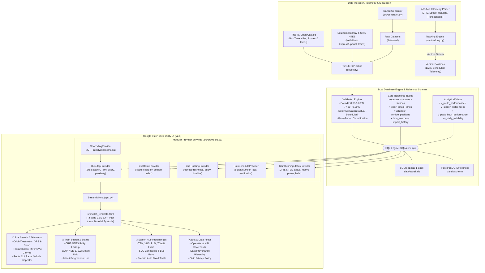

# System Architecture & Technical Specifications

## 1. Architectural Blueprint

The **Tirunelveli Public Transport Intelligence Platform (Nellai Transit)** is built on a modular, decoupled architecture consisting of Data Ingestion & Governance, Dual Relational Storage, a Dedicated Provider Layer, Analytical Modeling, Geospatial & Vector Mapping, and the **Google Stitch Civic Utility Presentation Layer (v2.5)**.

---

## 2. Component Descriptions

### Ingestion & Master Transit Data (`src/tirunelveli_data.py`, `src/generator.py`, `src/etl.py`)
- **Tirunelveli Master Transit Catalog**: Defines 3 authentic operators (`AGENCY-TNSTC`, `AGENCY-SR`, `AGENCY-SETC`), 10 routes with verified stop sequences, 20 stations with GPS coordinates across key hubs (Junction, New Bus Stand, Palayamkottai, Town, Ambasamudram, Tenkasi, Tiruchendur), and chronic bottleneck stations.
- **Data Cleaner & Coordinate Validator**: Validates that all station and vehicle coordinates fall strictly within the Tirunelveli bounding box ($8.30^\circ - 9.00^\circ\text{ N}, 77.30^\circ - 78.20^\circ\text{ E}$). Validates delay minutes, flags early/on-time/delayed statuses, and writes ingestion audit logs to `import_history`.

### Provider Layer (`src/providers.py`)
- **BusStopProvider**: Handles bus stop lookup, English and Tamil fuzzy searches, and Haversine distance computations (`find_nearest_stops`) to discover nearby stops from GPS coordinates or landmarks.
- **BusRouteProvider**: Enforces strict geographic eligibility (`is_route_eligible`), ensuring only routes serving verified Tirunelveli stops are returned.
- **BusTrackingProvider**: Provides honest real-time status and stop-by-stop timelines. In Production mode, it classifies data strictly as `SCHEDULED` or `STATIC` to prevent misleading simulated positions.
- **TrainScheduleProvider & TrainRunningStatusProvider**: Validates 5-digit Indian Railways train numbers, verifies local Tirunelveli eligibility, and generates platform numbers, current status, locomotive motive power (`WAP-7 ED 37102`, `WAP-4 ED`), block signals, speed, and full halt timetables.
- **GeocodingProvider**: In-memory catalog of prominent Tirunelveli landmarks (Vannarpettai, Anna Stadium, Nellaiyappar Temple, High Ground Medical College) for privacy-preserving offline proximity resolution without third-party API exposure.

### Google Stitch Civic Utility UI (`src/stitch_template.html` & `app.py`)
- **Austere Civic Utility Design System**: Implements the approved Google Stitch aesthetic (`stitch_tirunelveli_transit_tracker/`):
  - **Color Palette**: Municipal Slate (`#00507d`), Pine Teal (`#006a61`), Amber Status (`#8d4f00`), Critical Red (`#ba1a1a`), and Low-Contrast Surface Containers (`#f0f4f7`, `#eaeff2`).
  - **Typography**: Inter font with OpenType tabular figures (`tnum`) for timetable digit alignment; Material Symbols Outlined icons.
  - **2-Column Split Workspace**: 5-column left panel for search controls and route cards; 7-column right panel for vector maps and telemetry inspectors.
  - **Custom Vector Cartography**: Responsive SVG canvas depicting the Thamirabarani River path, Sulochana Mudaliar Bridge, radar pulsing vehicle beacon, and terminal concourse schematics.
  - **Station Hubs & Auto Tariffs**: Detailed intermodal interchange explorer with connecting city buses, rail departures, and Tirunelveli Traffic Police prepaid auto fixed tariffs.
  - **Embedded Streamlit Integration**: Seamlessly hosted via `streamlit.components.v1.html(height=1450, scrolling=True)` with Streamlit default chrome suppressed.

### Database Layer (`src/db.py` & `sql/`)
- Relational schema enforcing primary keys and foreign key constraints across 9 tables:
  1. `operators`: Transport operators and modes.
  2. `routes`: Multimodal transit lines and colors.
  3. `stations`: Physical station facilities and coordinates.
  4. `trips`: Timetabled trip instances.
  5. `actual_times`: Observed arrival and departure events.
  6. `vehicles`: Fleet inventory with accessibility and capacity.
  7. `vehicle_positions`: Timestamped vehicle telemetry and status.
  8. `data_sources`: Registered external feeds and connection states.
  9. `import_history`: Ingestion audit log and pipeline metrics.
- Dual-compatibility: SQLite for zero-configuration local Windows evaluation, and PostgreSQL DDL (`sql/postgres_setup.sql`) for production deployments.

### Analytics Engine (`src/analytics.py`)
- Computes fleet-wide and operator-specific KPIs.
- Filters datasets dynamically across user-selected routes, date windows, time periods, and service regimes.
- Computes Transit Reliability Index (TRI) using the standardized weighted formulation.

---

## 3. Technology Stack Reference

| Component | Technology | Specification / Version | Role |
| :--- | :--- | :--- | :--- |
| **Civic Design System** | Google Stitch UI | v2.5 (Austere Civic Utility) | High-contrast municipal interface, tabular alignment, 4px crisp borders |
| **Presentation Host** | Streamlit | >=1.40.0 | Python session state, iframe orchestrator, embedded web view |
| **Styling Engine** | Tailwind CSS | 3.4+ CDN | Low-contrast civic palette, 12-column grid, responsive mobile navigation |
| **Typography & Icons** | Inter & Material Symbols | Google Fonts | Tabular figures (`tnum`) for vertical number alignment; Material Symbols Outlined |
| **Vector Cartography** | Scalable Vector Graphics | W3C SVG Standard | Thamirabarani River plot, bridge crossing, radar beacon, and concourse schematics |
| **Geospatial Mapping** | Folium / Leaflet | >=0.17.0 | District overview maps, route polylines, station nodes |
| **Telemetry Protocols** | AIS-140 & CRIS NTES | Telemetry Engine | Transponder parsing, locomotive motive power, block signals, speed & heading |
| **Backend & Providers** | Python | 3.12 | Modular provider layer (BusStop, BusRoute, BusTracking, TrainSchedule, etc.) |
| **Database Engines** | SQLite & PostgreSQL | Dual Relational Engine | Zero-setup local SQLite (`data/transit.db`) and production PostgreSQL DDL |
| **Data Processing** | Pandas & NumPy | >=2.2.0 | Schedule manipulation, delay variance calculations, and KPI facts |
| **Charts & Analytics** | Plotly & Plotly Express | >=5.22.0 | Trend analysis, delay cascades, and Transit Reliability Index (TRI) |
| **Testing & QA** | Pytest | >=9.1.0 | **37 automated tests across 9 test suites (100% pass rate)** |
