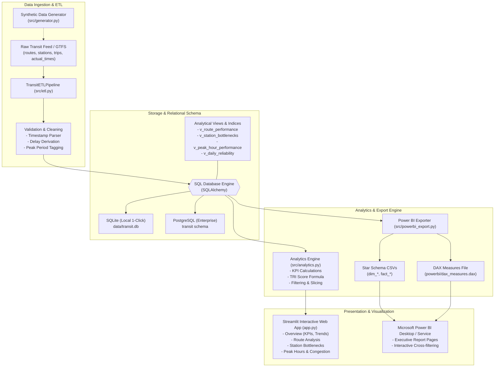

# System Architecture & Technical Specifications

## 1. Architectural Blueprint

The **Public Transit Delay Analytics Dashboard** follows a modular, decoupled architecture consisting of Data Ingestion, Relational Storage, Analytical Modeling, and Dual-Frontend Presentation layers.

## 2. Component Descriptions

### Ingestion & Transformation (`src/etl.py` & `src/generator.py`)
- **Stochastic Transit Generator**: Creates realistic timetable departures across 30 days with time-of-day travel densities, passenger dwell times, bottleneck dwell spikes, and incident shocks.
- **Data Cleaner**: Cleans and normalizes foreign key constraints, calculates delay minutes accurately as $(\text{actual} - \text{scheduled})$, and tags peak hours, weekdays, and status classes.

### Database Layer (`src/db.py` & `sql/`)
- Relational schema enforcing primary keys and foreign key cascades across:
  - `routes`
  - `stations`
  - `trips`
  - `actual_times`
- Analytical views pre-computing route punctuality, station rankings, and daily reliability indices.
- Dual-compatibility: SQLite for instant local Windows evaluation without external server overhead, and PostgreSQL DDL (`sql/postgres_setup.sql`) for enterprise cloud environments.

### Analytics Engine (`src/analytics.py`)
- Computes multi-level KPIs and filters dataframes dynamically across user-selected routes, date windows, time periods, and service regimes.
- Computes Transit Reliability Index (TRI) using the standardized weighted formulation.

### Visual Presentation Layer (`app.py` & `powerbi/`)
- **Streamlit Web Dashboard**: Fully interactive with Plotly charts, metric cards, bubble maps, heatmaps, and data download utilities.
- **Power BI Deliverables**: Complete dimensional star schema with fact and dimension tables, DAX measures, and Power Query M transformations.
