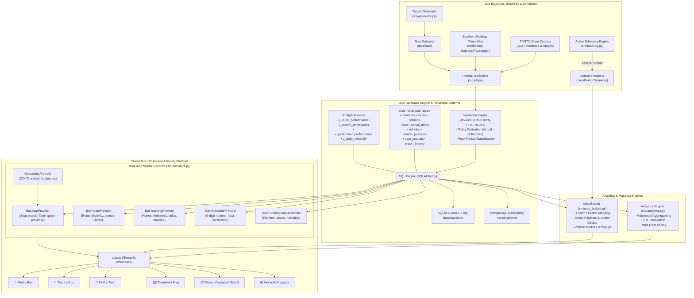

# System Architecture & Technical Specifications

## 1. Architectural Blueprint

The **Tirunelveli Public Transport Intelligence Platform (Nellai Transit)** is built on a modular, decoupled architecture consisting of Data Ingestion & Governance, Relational Storage, a Dedicated Provider Layer, Analytical Modeling, Geospatial Mapping, and a 6-Tab Human-Friendly Presentation Layer.

---

## 2. Component Descriptions

### Ingestion & Master Transit Data (`src/tirunelveli_data.py`, `src/generator.py`, `src/etl.py`)
- **Tirunelveli Master Transit Catalog**: Defines 3 authentic operators (`AGENCY-TNSTC`, `AGENCY-SR`, `AGENCY-SETC`), 10 routes with verified stop sequences, 20 stations with GPS coordinates across key hubs (Junction, New Bus Stand, Palayamkottai, Town, Ambasamudram, Tenkasi, Tiruchendur), and chronic bottleneck stations.
- **Data Cleaner & Coordinate Validator**: Validates that all station and vehicle coordinates fall strictly within the Tirunelveli bounding box ($8.30^\circ - 9.00^\circ\text{ N}, 77.30^\circ - 78.20^\circ\text{ E}$). Validates delay minutes, flags early/on-time/delayed statuses, and writes ingestion audit logs to `import_history`.

### Provider Layer (`src/providers.py`)
- **BusStopProvider**: Handles bus stop lookup, English and Tamil fuzzy searches, and Haversine distance computations (`find_nearest_stops`) to discover nearby stops from GPS coordinates or landmarks.
- **BusRouteProvider**: Enforces strict geographic eligibility (`is_route_eligible`), ensuring only routes serving verified Tirunelveli stops are returned.
- **BusTrackingProvider**: Provides honest real-time status and stop-by-stop timelines. In Production mode, it classifies data strictly as `SCHEDULED` or `STATIC` to prevent misleading simulated positions.
- **TrainScheduleProvider & TrainRunningStatusProvider**: Validates 5-digit Indian Railways train numbers, verifies local Tirunelveli eligibility, and generates platform numbers, current status, and full halt timetables.
- **GeocodingProvider**: In-memory catalog of prominent Tirunelveli landmarks (Vannarpettai, Anna Stadium, Nellaiyappar Temple, High Ground Medical College) for privacy-preserving offline proximity resolution without third-party API exposure.

### Vehicle Tracking & Live Telemetry (`src/tracking.py` & `src/map_builder.py`)
- **Tracking Engine**: Manages vehicle location retrieval with authentic Tirunelveli bus numbers (`TN-72-N-xxxx`) and Southern Railway train numbers (*12632 Nellai Express*, *20666 Vande Bharat*, *06682 Tiruchendur Special*).
- **Leaflet / Folium Map Builder**: Renders interactive map layers with custom operator styling (TNSTC amber, Southern Railway red/green), station popups, and vehicle markers.

### Database Layer (`src/db.py` & `sql/`)
- Relational schema enforcing primary keys and foreign key constraints across 9 tables:
  1. `operators`: Transport operators and modes.
  2. `routes`: Multimodal transit lines and colors.
  3. `stations`: Physical station facilities and coordinates.
  4. `trips`: Timetabled trip instances.
  5. `actual_times`: Observed arrival and departure events.
  6. `vehicles`: Fleet inventory with accessibility and capacity.
  7. `vehicle_positions`: Timestamped vehicle telemetry and status.
  8. `data_sources`: Registered external feeds and connection states.
  9. `import_history`: Ingestion audit log and pipeline metrics.
- Dual-compatibility: SQLite for zero-configuration local Windows evaluation, and PostgreSQL DDL (`sql/postgres_setup.sql`) for production deployments.

### Analytics Engine (`src/analytics.py`)
- Computes fleet-wide and operator-specific KPIs.
- Filters datasets dynamically across user-selected routes, date windows, time periods, and service regimes.
- Computes Transit Reliability Index (TRI) using the standardized weighted formulation.
